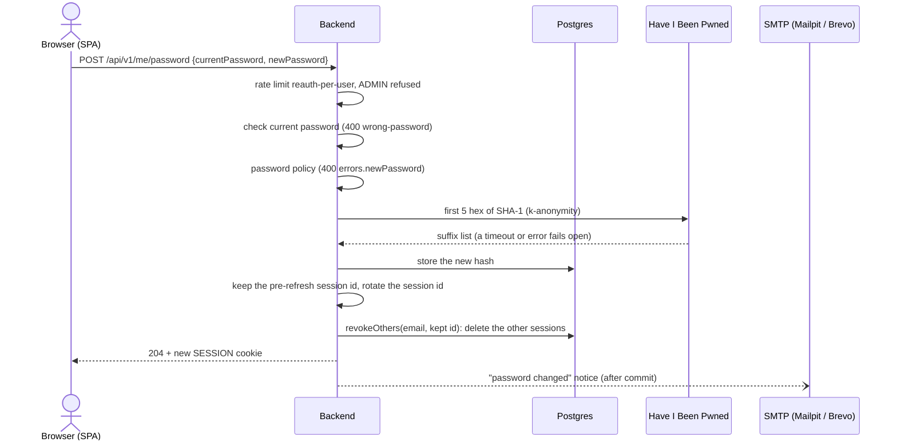
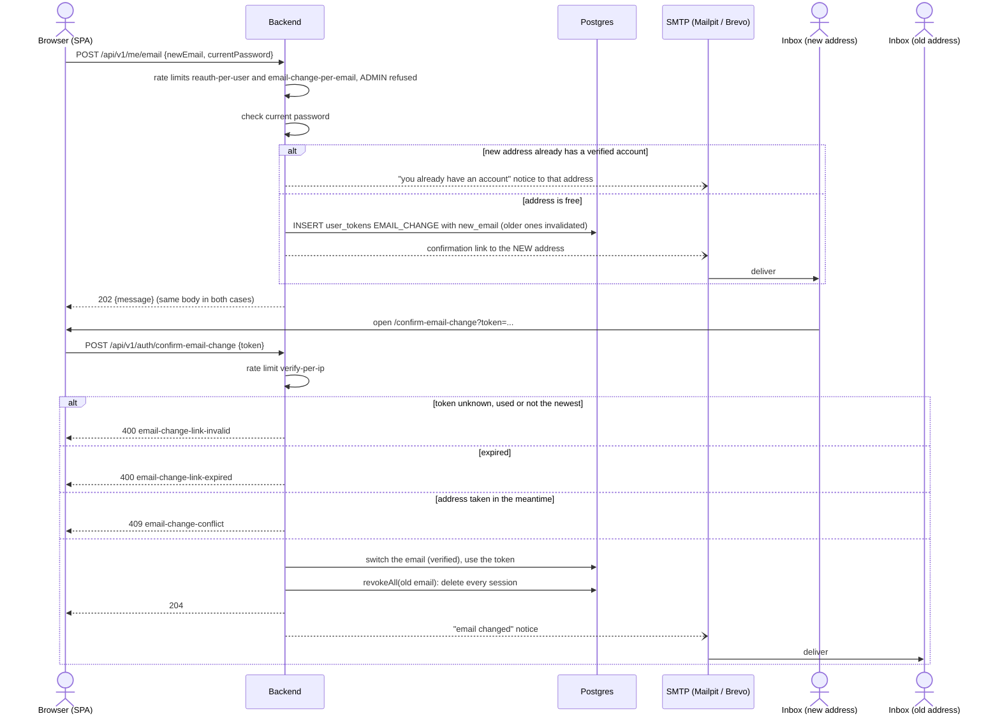
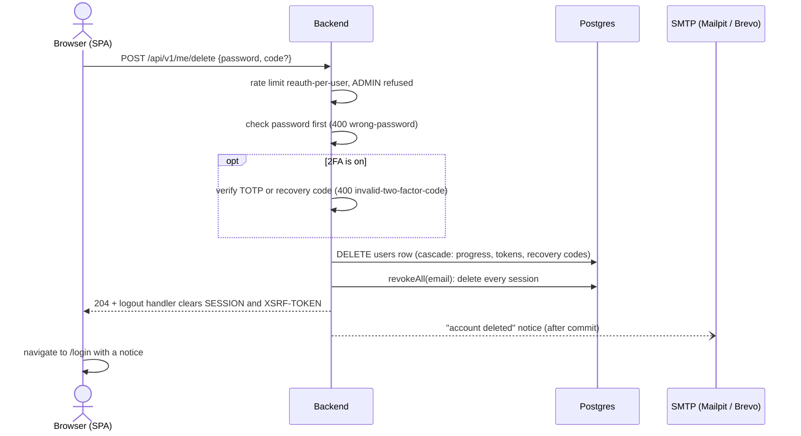
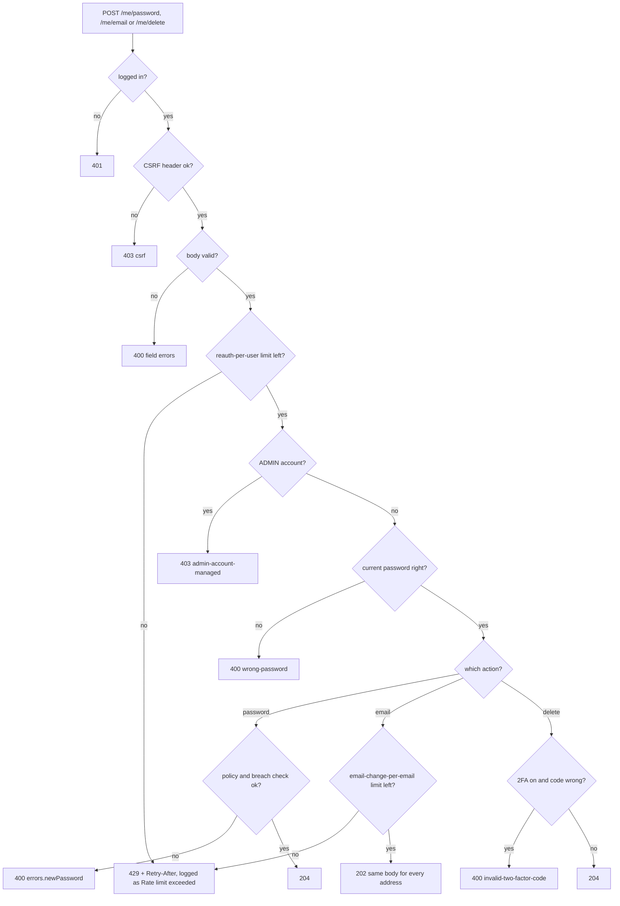

# Account management flow

Signed-in users change their password, change their email or delete their account. All three `/me` actions are `POST`,
need the `SESSION` cookie and the CSRF header, and re-check the **current password** (`reauth-per-user`: 5 per 15 min per
account). ADMIN accounts are refused with `403 admin-account-managed`. Mail is sent after the database commit, so SMTP
trouble never fails a request.

## Change password

## Change email

The authenticator-app label keeps the old email until 2FA is set up again.

## Delete account

Deletion touches the live database only; a backup taken earlier can still hold the account for its retention period.

## What is refused, and with which status

## Accounts created by Google sign-in

An account without a password (`hasPassword: false`) answers `400 wrong-password` to all three actions and to 2FA setup,
because there is no current password to check. The SPA hides those forms and shows "Set a password": it posts
`forgot-password` for the account's own address, the emailed link sets the password and closes every session, and the
account then behaves like any other. See [google-sign-in-flow.md](google-sign-in-flow.md).
