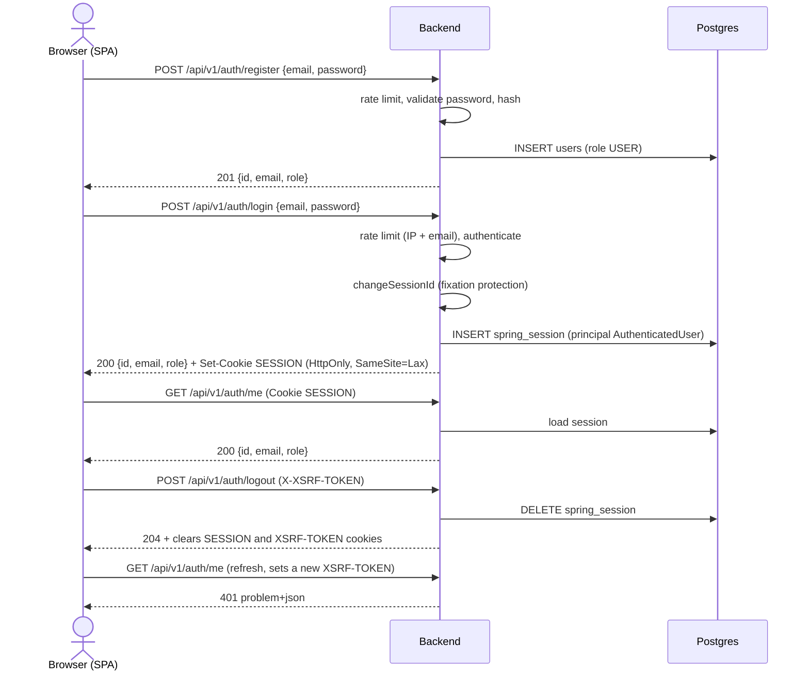
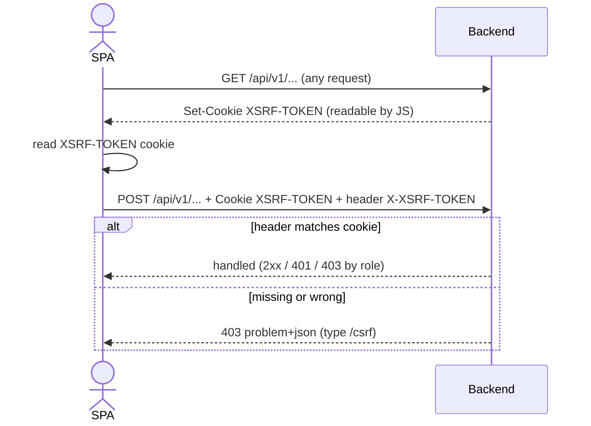
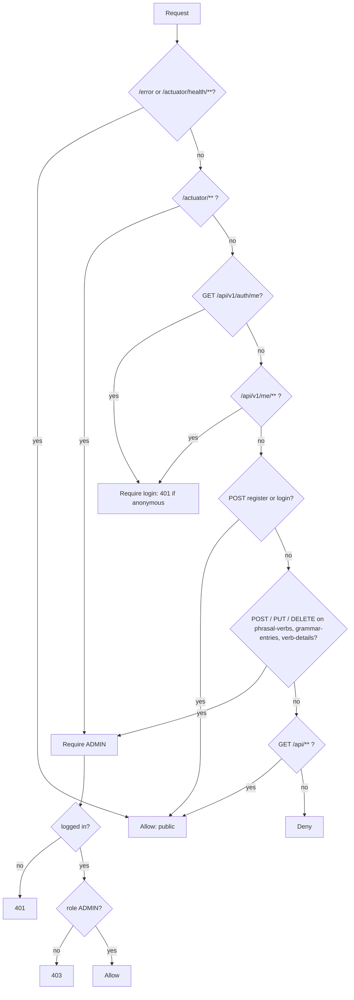

# Auth flow

Session-based auth inside Spring Boot (Spring Security 7 + Spring Session JDBC). The SPA and API share one origin.

## Register, login, me, logout

## CSRF cookie-to-header on a write

## Authorization rules

## Deferred

Email verification (and Mailpit), password reset, TOTP 2FA, Google sign-in, ~~server-side quiz progress~~ (done, see [quiz-progress-flow.md](quiz-progress-flow.md)).
