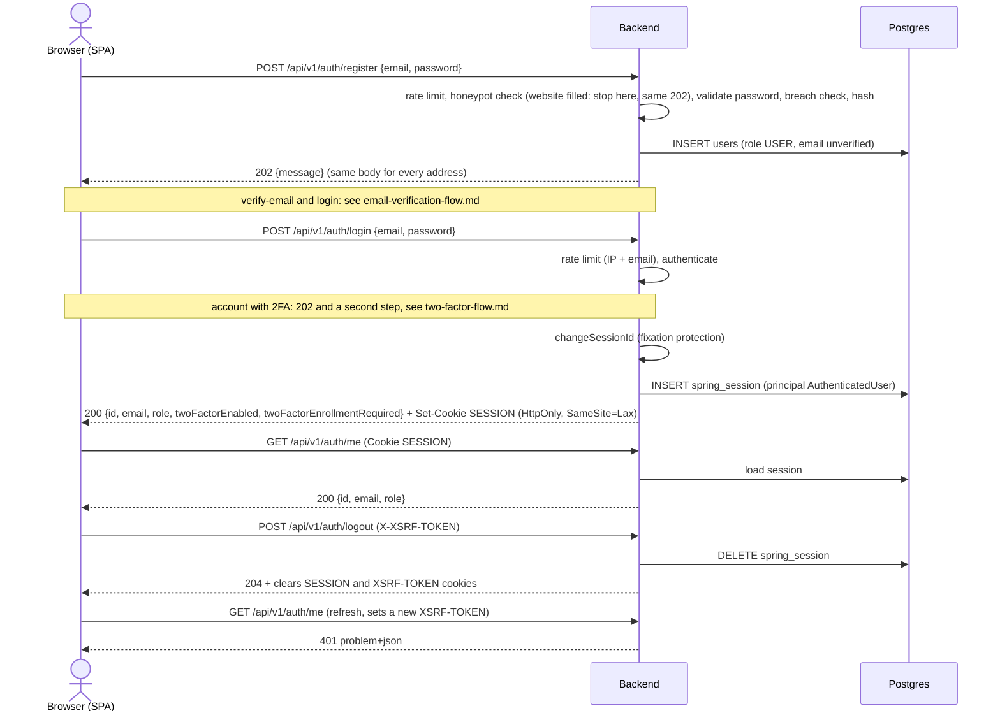
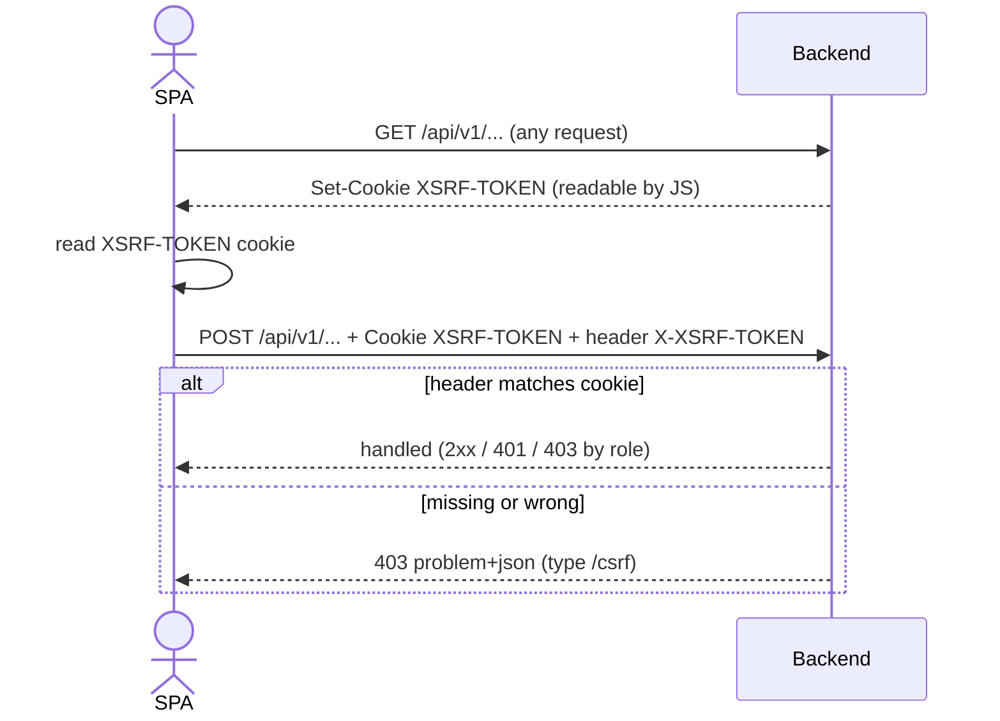
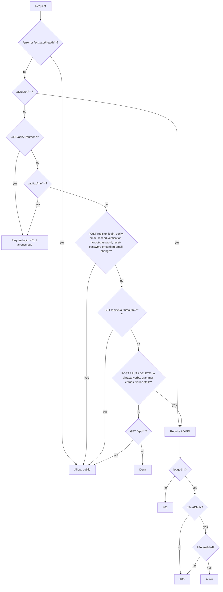

# Auth flow

Session-based auth inside Spring Boot (Spring Security 7 + Spring Session JDBC). The SPA and API share one origin.

## Register, login, me, logout

## CSRF cookie-to-header on a write

## Authorization rules

## Google as a second entry

Besides the password login, a visitor can start `GET /api/v1/auth/oauth2/authorization/google`. The callback ends in the
same session as password login (`SessionAuthenticator#signInVerified`), or in the pending 2FA step. The SPA asks
`GET /api/v1/auth/providers` (public, `{"google": bool}`) before it shows the button. `/auth/me` and `login` answers carry
`hasPassword`. Rules, refusals and the mock provider: [google-sign-in-flow.md](google-sign-in-flow.md).

## Account settings

Signed-in users change their password, change their email or delete their account through `/api/v1/me/password|email|delete`
(rules, sessions and mails: [account-management-flow.md](account-management-flow.md)). The only public endpoint of that
feature is `POST /api/v1/auth/confirm-email-change`, which opens from the link mailed to the new address.

## Deferred

~~TOTP 2FA~~ (done, see [two-factor-flow.md](two-factor-flow.md)), ~~Google sign-in~~ (done, see [google-sign-in-flow.md](google-sign-in-flow.md)), ~~password reset~~ (done, see [password-reset-flow.md](password-reset-flow.md)), ~~email verification~~ (done, see [email-verification-flow.md](email-verification-flow.md)), ~~server-side quiz progress~~ (done, see [quiz-progress-flow.md](quiz-progress-flow.md)).
