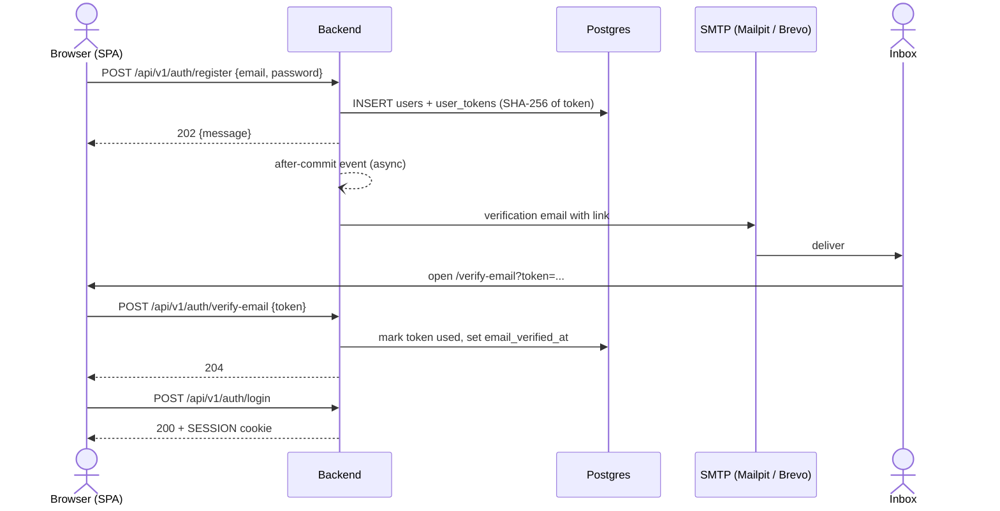
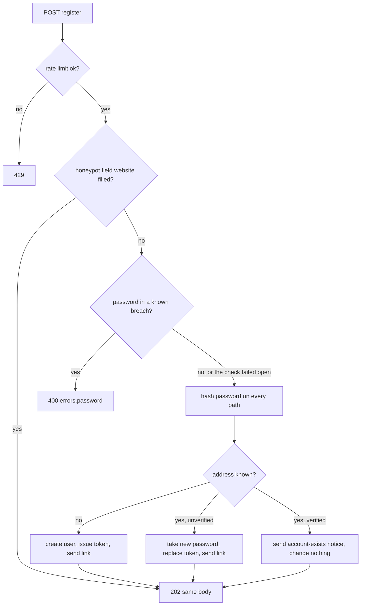
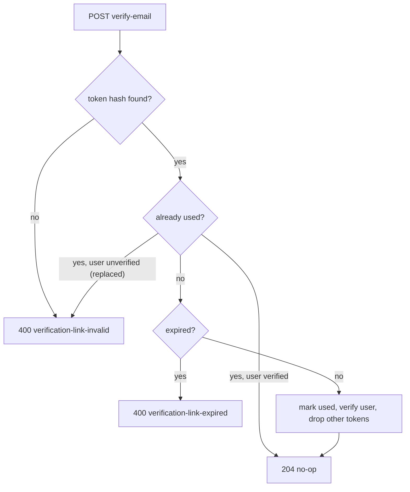

# Email verification flow

The link points at the SPA (`${APP_BASE_URL}/verify-email?token=...`); the page posts the token to the API.
Mail is sent after the database commit, so SMTP trouble never fails a request.

## Sign-up to first login



## Register branches



## Verify outcomes



## Login of an unverified account

```mermaid
sequenceDiagram
    actor U as Browser (SPA)
    participant B as Backend

    U->>B: POST /api/v1/auth/login {email, password}
    B->>B: rate limit, then check password (pre-checks are a no-op)
    alt wrong password or unknown email
        B-->>U: 401
    else password ok, email unverified
        B-->>U: 403 email-not-verified (SPA offers a new link)
    else password ok, verified
        B-->>U: 200 + SESSION cookie
    end
    U->>B: POST /api/v1/auth/resend-verification {email}
    B-->>U: 202 (always; mail only for unverified accounts)
```

A filled honeypot gets the same `202` as everything else but creates nothing and sends nothing, so a bot cannot tell it
was caught. The "account exists" notice also answers an email-change request to an address that already has a verified
account: it says someone tried to use the address for a Phrasal account, and links to the login page.
