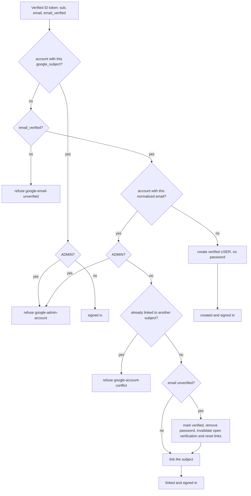

# Google sign-in flow

"Continue with Google" is a second way into the session described in [auth-flow.md](auth-flow.md). It is OpenID Connect
(authorization code flow) through Spring Security's `oauth2Login`, on only when `GOOGLE_LOGIN_ENABLED=true`. The ID token
proves the identity; the session still holds the `AuthenticatedUser` record, never the OIDC token.

## Sign-in

```mermaid
sequenceDiagram
    actor U as Browser (SPA)
    participant B as Backend
    participant G as Google (mock-oauth2 locally)
    participant S as GoogleOidcUserService / GoogleSignInService
    participant DB as Postgres

    U->>B: GET /api/v1/auth/providers
    B-->>U: {"google": true} (the SPA shows the button only then)
    U->>B: GET /api/v1/auth/oauth2/authorization/google (link, full page navigation)
    B->>B: state and nonce kept in the session
    B-->>U: 302 Google authorize (client_id, scope openid email profile, state, nonce, redirect_uri = APP_BASE_URL + /api/v1/auth/oauth2/code/google)
    U->>G: sign in and consent
    G-->>U: 302 redirect_uri?code&state
    U->>B: GET /api/v1/auth/oauth2/code/google
    B->>G: POST token endpoint (server to server)
    G-->>B: ID token (signed, checked: issuer, audience, nonce, expiry)
    B->>S: verified claims (sub, email, email_verified)
    S->>DB: find by google_subject, then by email; link or create
    alt signed in, linked or created
        B->>B: SessionAuthenticator#signInVerified
        alt account has 2FA
            B-->>U: 302 /login/2fa (pending login, see two-factor-flow.md)
        else
            B-->>U: 302 / + SESSION cookie
        end
    else refused or any OAuth2 error
        B-->>U: 302 /login?error=code (SPA shows a fixed text and clears the code from the URL)
    end
```

## Matching rules



Google never changes the account email. Any other failure (`access_denied`, wrong or replayed `state`, bad token, two
first sign-ins at once) ends at `/login?error=google`. Nothing is written when a sign-in is refused.

## Accounts without a password

A Google-created account has no password hash (`hasPassword: false` in `/auth/me`). Password login answers the usual
`401`. On Account security the SPA shows "Set a password" instead of the change-password, change-email, delete and
2FA-enable forms: it calls `forgot-password` for the account's own address, and the emailed link
([password-reset-flow.md](password-reset-flow.md)) sets the password and closes every session.

## Local development and e2e

`docker-compose.yml` runs `mock-oauth2` (http://localhost:8090) and points the backend at it with the `GOOGLE_*_URI`
overrides: the browser reaches it on `localhost`, the backend as `mock-oauth2:8080`. Its form takes a username (the
`sub`) and claims as JSON (`{"email": "...", "email_verified": true}`). Real Google needs only the client id and secret.
