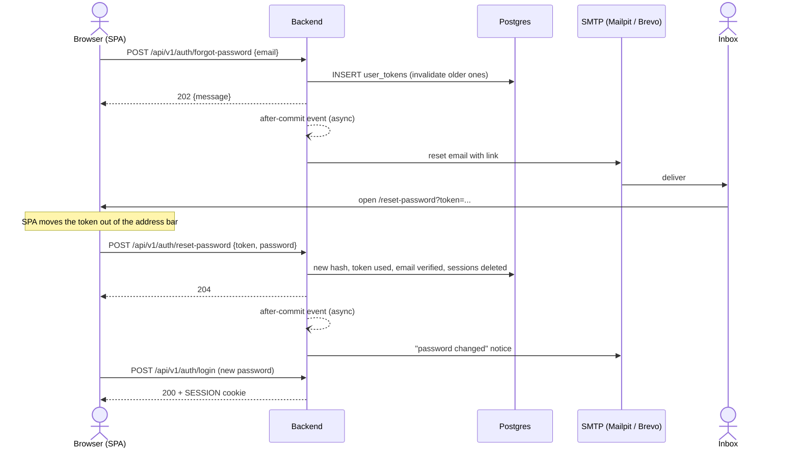
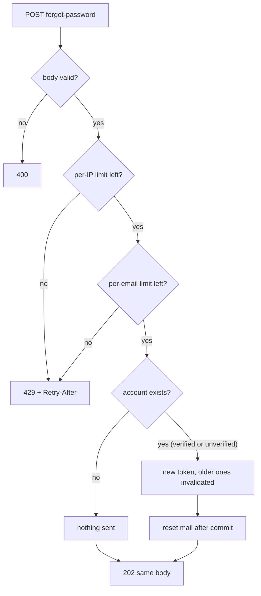
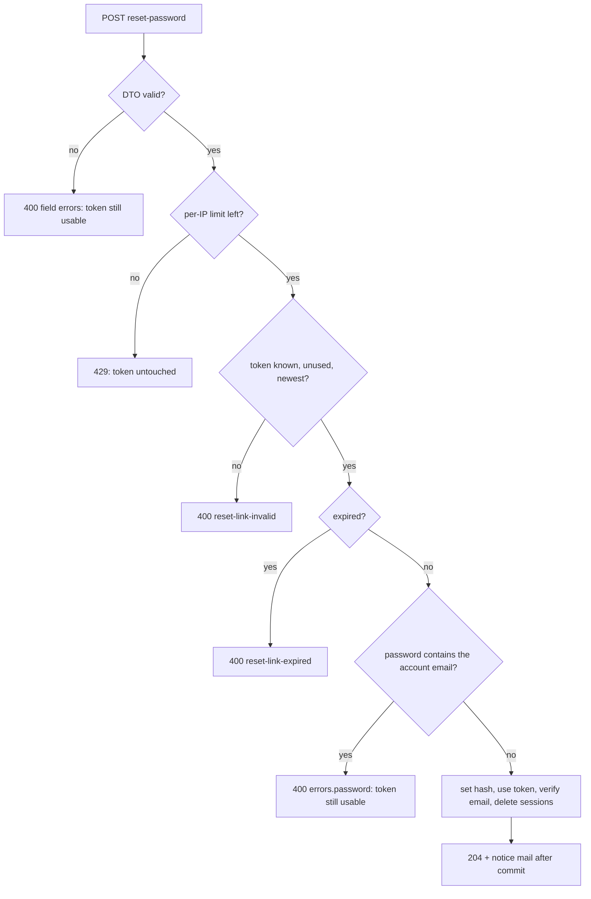

# Password reset flow

The link points at the SPA (`${APP_BASE_URL}/reset-password?token=...`); the page posts the token and the new password to
the API. Mail is sent after the database commit, so SMTP trouble never fails a request. Tokens live in `user_tokens` with
type `PASSWORD_RESET` (SHA-256 stored, single use, newest only, TTL `PASSWORD_RESET_TOKEN_TTL`, default 1 h).

## Forgot to new password

## Forgot-password outcomes

The answer is the same `202` on every path, so it cannot reveal which addresses have an account.

## Reset-password checks, in order

The rate limits run after body validation and before any lookup. Failures that keep the token usable: DTO validation, rate limit and the email rule. Invalid and expired links end the flow;
the user asks for a new link. A reset does not log anyone in; the admin password is re-applied from
`PHRASAL_ADMIN_PASSWORD` at the next backend start.
