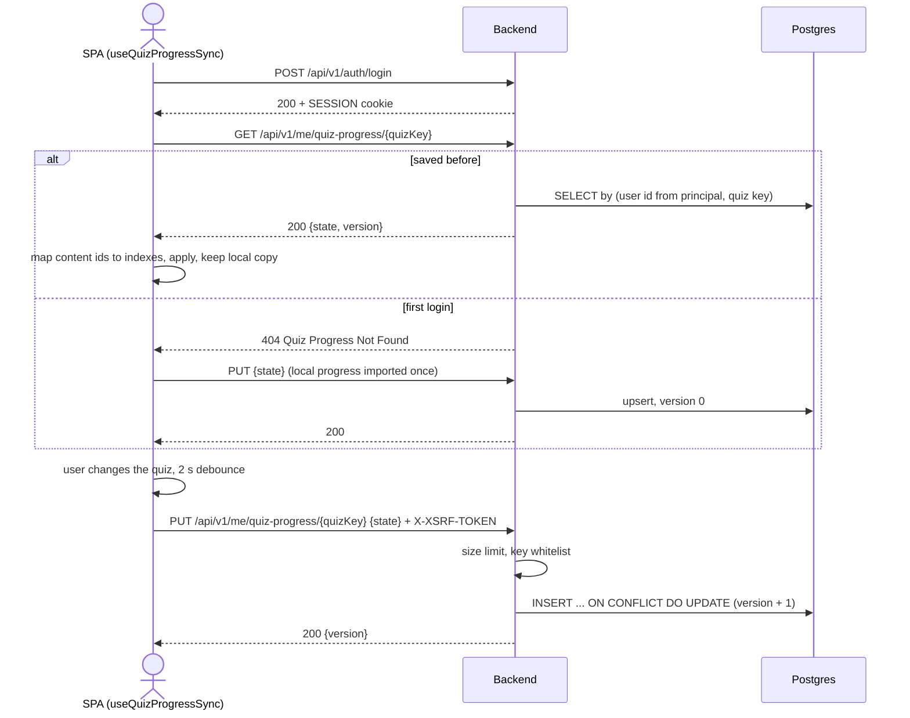
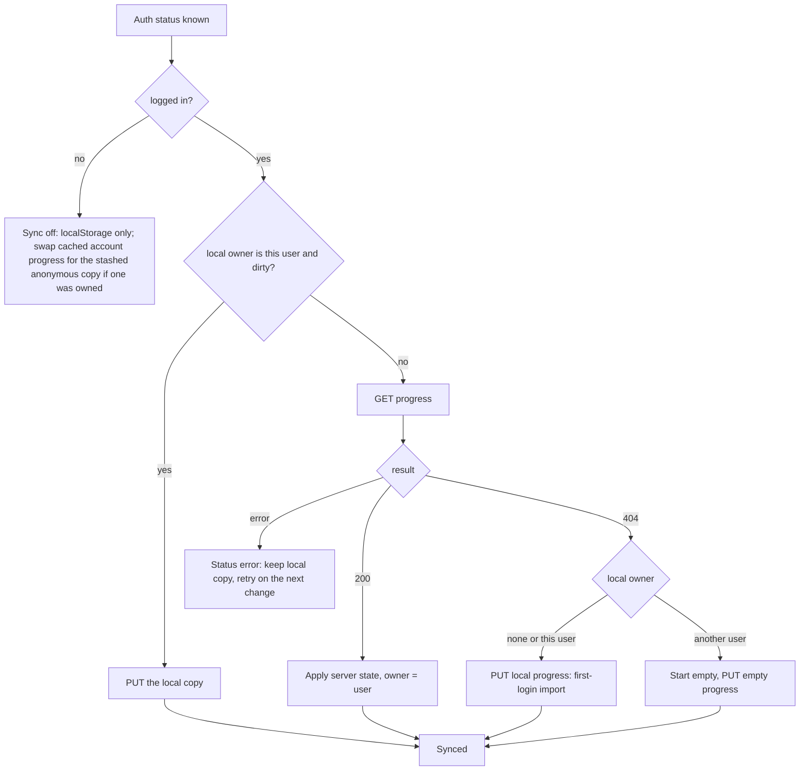
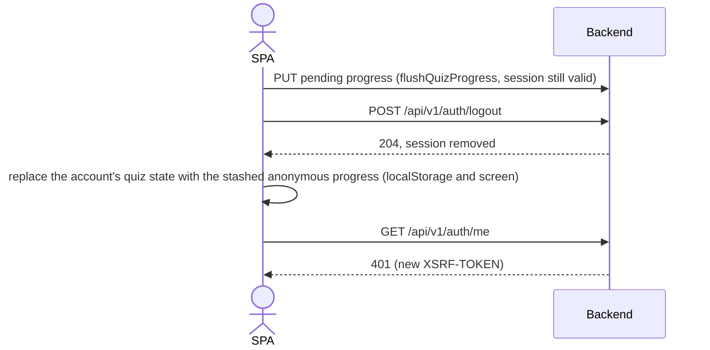

# Quiz progress flow

Per-user quiz progress (`user_quiz_progress`, one JSON document per user and quiz key). Anonymous visitors stay on
`localStorage` and send no progress requests.

## Login, load, debounced save

## Load decision

## Logout

