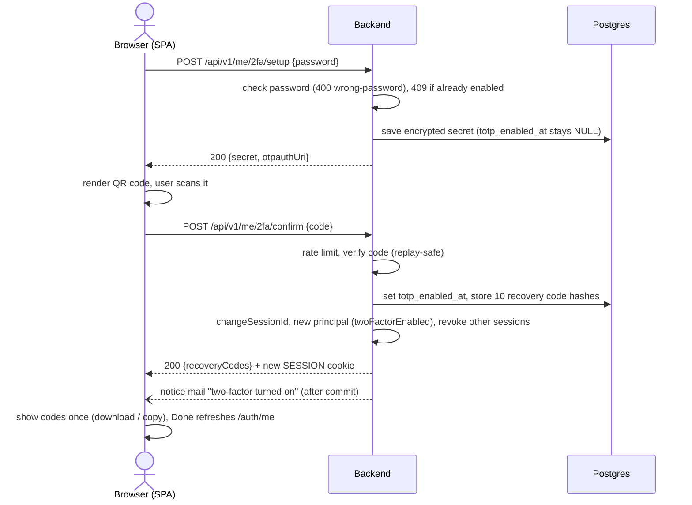
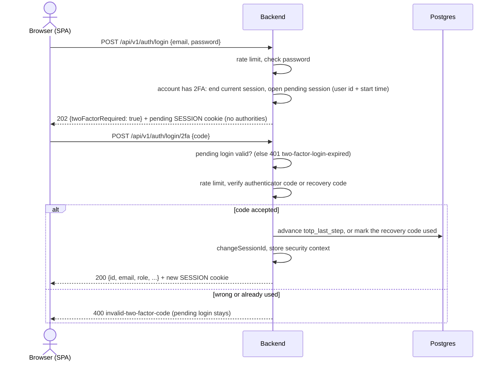
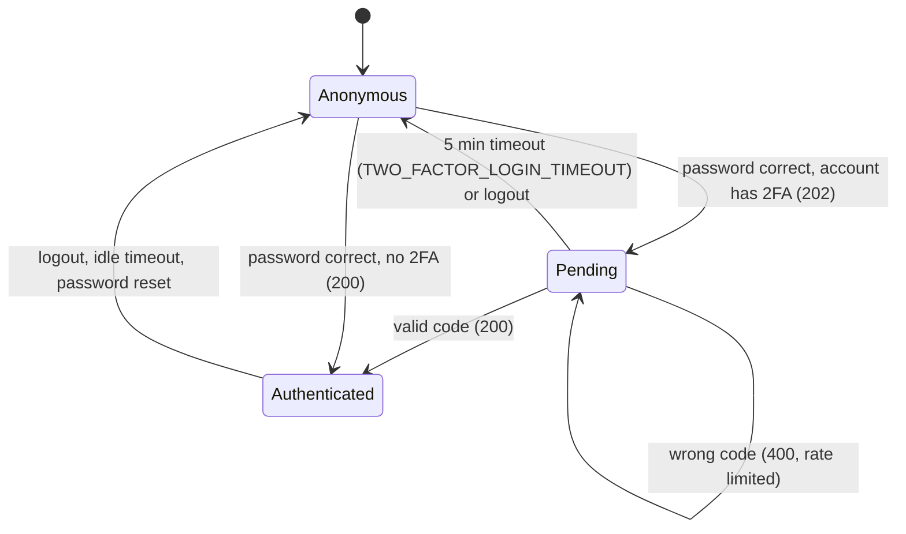
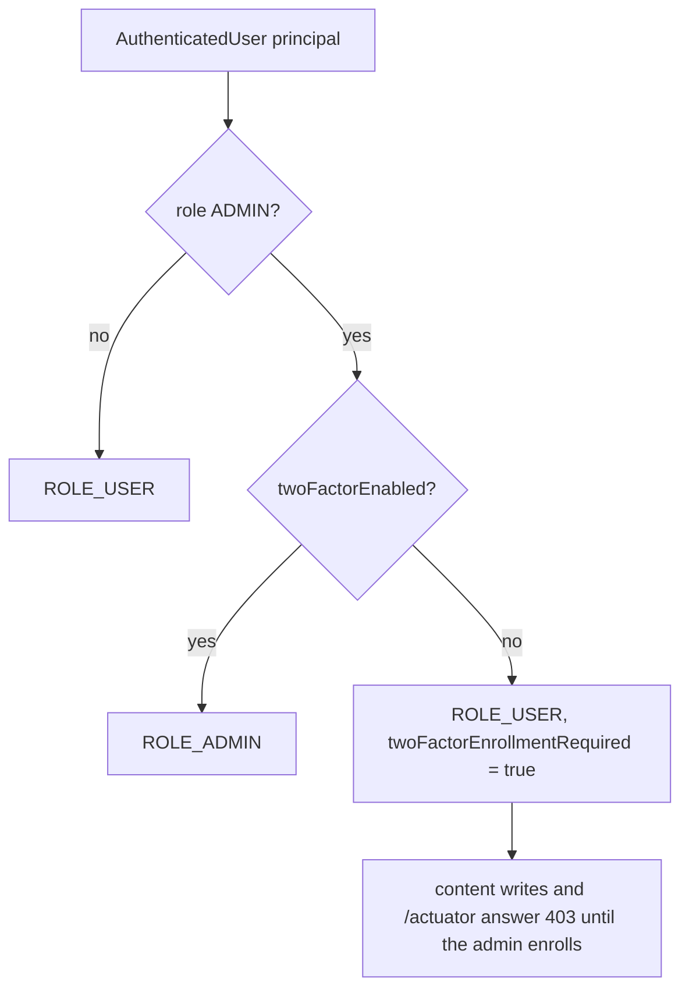

# Two-factor authentication flow

TOTP 2FA (RFC 6238) on top of the session login in [auth-flow.md](auth-flow.md). The TOTP secret is stored AES-GCM
encrypted (key: `TOTP_ENCRYPTION_KEY`); recovery codes are stored as SHA-256 hashes.

## Enrollment

## Two-step login

## Login states

## Authority decision

## Deferred

- 2FA for Google sign-in (task-104): `SessionAuthenticator#startTwoFactorChallenge` is the seam; `setup` asks for the
  password, so Google-only accounts need another proof.
- Encryption key rotation: changing `TOTP_ENCRYPTION_KEY` invalidates every stored secret, so every 2FA user needs a
  recovery code and must enroll again.
